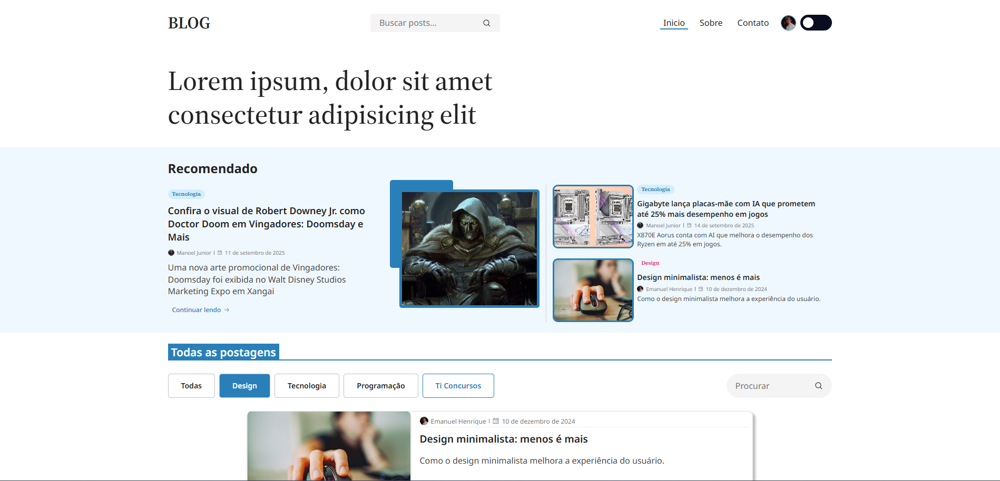
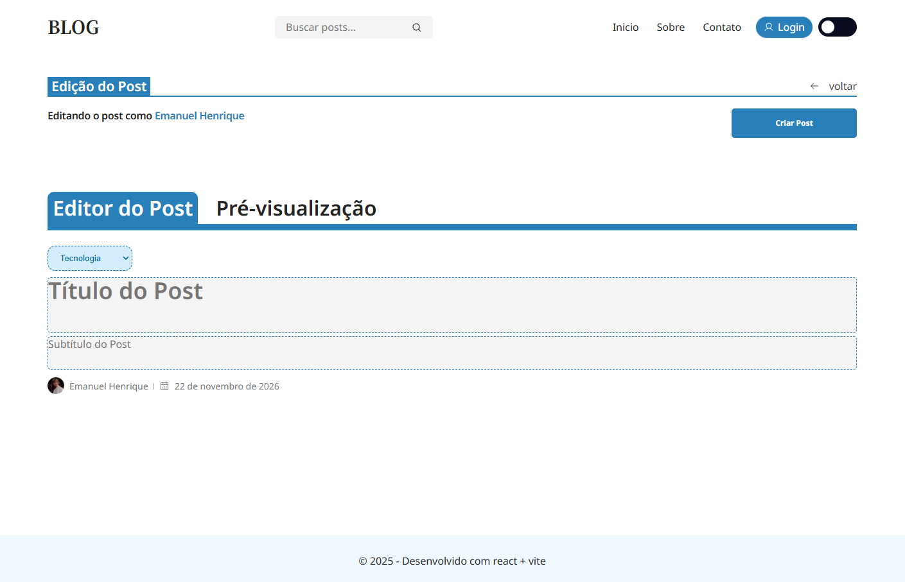

# Blog React + TypeScript + Vite

<p align="center">
  
  
  
  
  <a href="https://github.com/emanuelhenrique-dev/blog-reactVite/commits/main">
    
  </a>
  <a href="https://github.com/emanuelhenrique-dev/blog-reactVite/issues">
    
  </a>
</p>

<p align="center">
  <a href="https://meu-blog-react.vercel.app" target="_blank">
    
  </a>
  <a href="https://github.com/emanuelhenrique-dev/blog-reactVite" target="_blank">
    
  </a>
</p>

Projeto de demonstração de um blog desenvolvido com React, TypeScript e Vite. A aplicação inclui páginas públicas, visualização de artigos, busca, temas e uma área administrativa para gerenciar publicações.

## Demonstração

<p align="center">
  
</p>

<p align="center">
  <em>Página inicial com destaques, filtros e listagem de posts.</em>
</p>

### Gerenciamento de posts

<p align="center">
  
</p>

<p align="center">
  
</p>

## Visão geral

- Página inicial com destaques e lista de posts
- Visualização completa de cada publicação
- Busca por posts
- Páginas Sobre e Contato
- Tema claro e tema escuro
- Painel administrativo protegido por login
- Criação, edição, visualização e exclusão de posts
- Interface responsiva com estilos em `styled-components`
- Editor de conteúdo baseado em `Editor.js`

## Tecnologias usadas

- React 19
- TypeScript
- Vite
- React Router
- Styled Components
- React Hook Form
- Zod
- Editor.js
- Phosphor Icons
- DOMPurify
- Immer
- UUID

## Funcionalidades do blog

- Navegação entre páginas públicas
- Listagem de posts em destaque
- Listagem completa de artigos
- Página detalhada de cada post
- Busca por título ou conteúdo
- Compartilhamento de links
- Alternância entre tema claro e escuro
- Seções de apresentação e contato
- Administração de posts por meio do dashboard

## Estrutura do projeto

- `src/pages/`: páginas e rotas da aplicação
- `src/pages/DashboardAdmin/`: tela de login administrativa
- `src/pages/PostsManager/`: listagem, criação, edição e visualização de posts
- `src/components/`: componentes reutilizáveis
- `src/layouts/`: layouts compartilhados
- `src/contexts/`: contextos de tema e posts
- `src/data/`: dados locais de usuários e publicações
- `src/reducers/`: ações e estado dos posts
- `src/loaders/`: loaders das rotas
- `src/styles/`: estilos globais e temas
- `public/`: imagens e outros arquivos estáticos

## Acesso à administração

O painel administrativo é disponível em:

**[https://meu-blog-react.vercel.app/dashboard2490admin](https://meu-blog-react.vercel.app/dashboard2490admin)**

Essa rota apresenta o formulário de login do administrador. Após informar uma das credenciais abaixo e entrar, o usuário é direcionado para o gerenciador de posts.

| Usuário | Senha |
| --- | --- |
| `Manoel` | `123456` |
| `Emanuel` | `654321` |

No gerenciador, é possível:

- listar os posts existentes;
- criar uma nova publicação;
- visualizar os detalhes de um post;
- editar uma publicação existente;
- remover posts da demonstração.

> As credenciais são destinadas exclusivamente à demonstração do projeto. A autenticação e os dados estão implementados no front-end; para uso em produção, deve-se substituir essa implementação por autenticação segura no servidor e persistência em banco de dados.

As credenciais válidas são definidas em `src/data/users.ts`. Após o login, a aplicação salva no `localStorage` os estados `isLoggedInAdmin` e `adminUser`, que são usados para permitir o acesso às rotas privadas do painel.

## Como rodar localmente

### Pré-requisitos

- Node.js
- npm

### Instalação e execução

```bash
npm install
npm run dev
```

Após iniciar o servidor, acesse a URL exibida pelo Vite no terminal.

Para abrir o painel localmente, acesse:

```text
http://localhost:5173/dashboard2490admin
```

### Comandos disponíveis

```bash
npm run dev      # inicia o servidor de desenvolvimento
npm run build    # gera a versão de produção
npm run lint     # executa o ESLint
npm run preview  # visualiza a versão de produção
```

## Observações

- O projeto utiliza dados locais para a demonstração.
- A sessão administrativa fica armazenada no navegador por meio do `localStorage`.
- O acesso privado é feito pelas rotas iniciadas em `/dashboard2490admin`.
- Este projeto não possui backend próprio nesta demonstração.
- Antes de publicar em produção, recomenda-se implementar autenticação e autorização no servidor.
